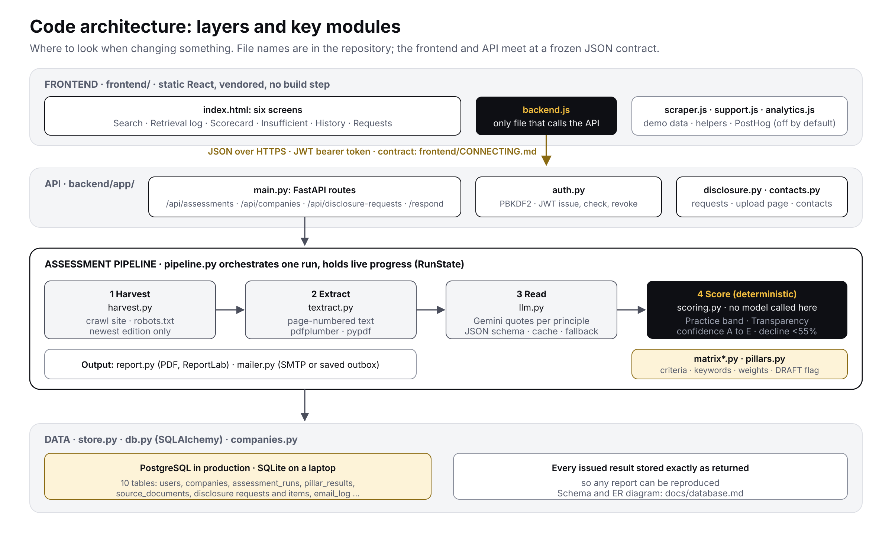
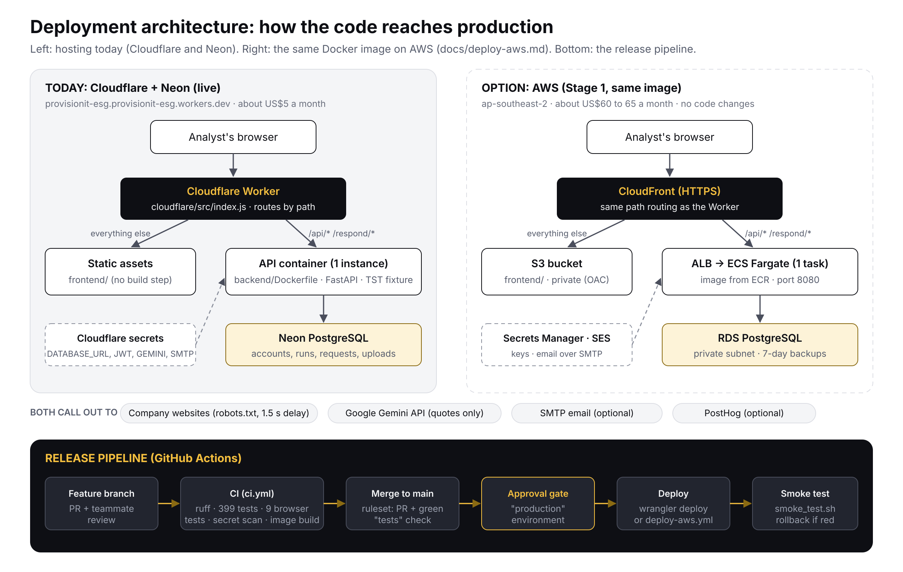

# Architecture

Two views of the platform. The Confluence pages *As-built architecture* and
*AWS deployment architecture* hold the design reasoning; this page is the quick
picture that lives with the code. Sources are SVG, so they can be edited.

## Code: layers and key modules

- **Frontend** (`frontend/`): six screens in `index.html`. `backend.js` is the only file that calls the API.
- **API** (`backend/app/main.py`): FastAPI routes, sign-in in `auth.py`, disclosure requests in `disclosure.py`.
- **Pipeline** (`pipeline.py`): harvest, extract, read, score. The language model only quotes; `scoring.py` decides, and no model is called there.
- **Data** (`store.py`, `db.py`): PostgreSQL in production, SQLite locally. Schema: [database.md](database.md).

Where to change what: [HANDOVER.md, section 9](../HANDOVER.md#9-architecture-layers-and-key-modules).

## Deployment: how the code reaches production

- **Today:** one Cloudflare Worker serves the website and forwards `/api/*` and `/respond/*` to the API container; PostgreSQL on Neon. Steps: [DEPLOY.md](../DEPLOY.md).
- **AWS option:** CloudFront routes the same paths to S3 and to an ECS Fargate task behind a load balancer; RDS PostgreSQL. Steps: [deploy-aws.md](deploy-aws.md).
- **Release pipeline:** pull request and review, CI (`ci.yml`), merge to `main` under the branch ruleset, approval gate, deploy (`deploy.yml` or `deploy-aws.yml`), smoke test (`scripts/smoke_test.sh`).
