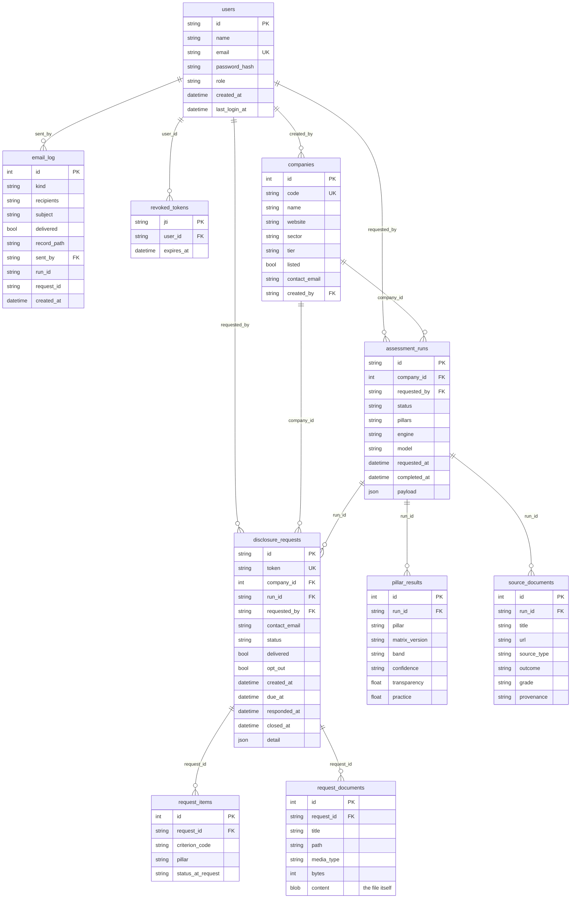

# Database

Relational schema in `backend/app/db.py` (SQLAlchemy). SQLite at
`backend/data/platform.db` on a laptop; PostgreSQL on Amazon RDS in the
deployment design, selected with `DATABASE_URL`. Tables are created on first
start.

The issued result of an assessment is kept exactly as the API returned it
(`assessment_runs.payload`) so any report can be reproduced. Everything that
is listed, filtered, joined or audited also lives in its own columns and
tables.

## Sign-in

`POST /api/auth/login` and `POST /api/auth/signup` return a JWT (HS256):

| Claim | Meaning |
|---|---|
| `sub` | user id |
| `name`, `email`, `role` | who is signed in |
| `iss` / `aud` | `provisionit-esg` / `provisionit-esg-api`, both checked |
| `iat`, `nbf`, `exp` | issued, valid from, expires (`JWT_EXPIRE_MINUTES`, default 480) |
| `jti` | unique id, recorded in `revoked_tokens` on sign-out |

Every `/api` route except health and sign-in requires
`Authorization: Bearer <token>`. Companies answering a disclosure request use
the single-purpose link token in their email and never sign in.

On AWS, Amazon Cognito issues the tokens and the API only verifies them;
`DATABASE_URL` points at RDS PostgreSQL (`pip install "psycopg[binary]"`).
